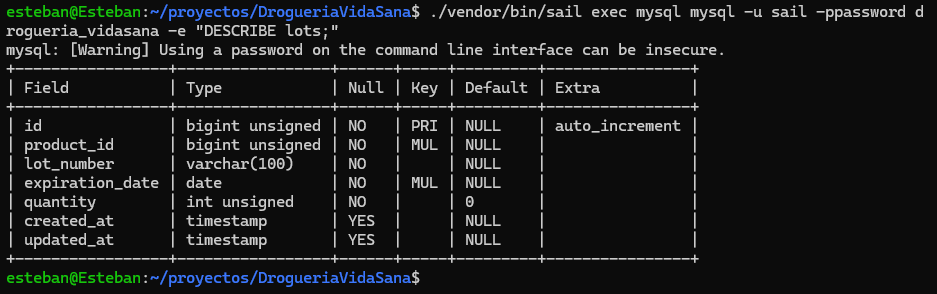
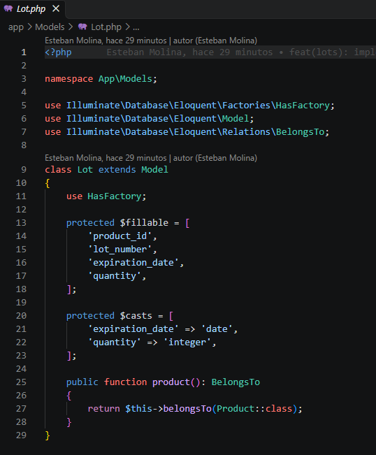
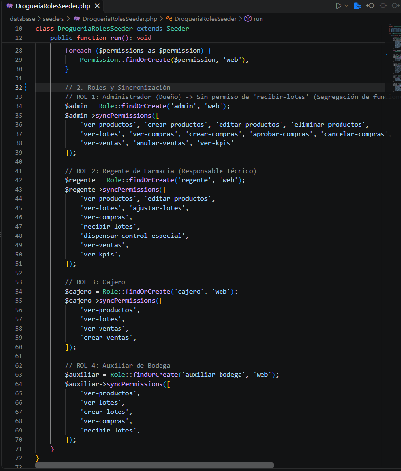
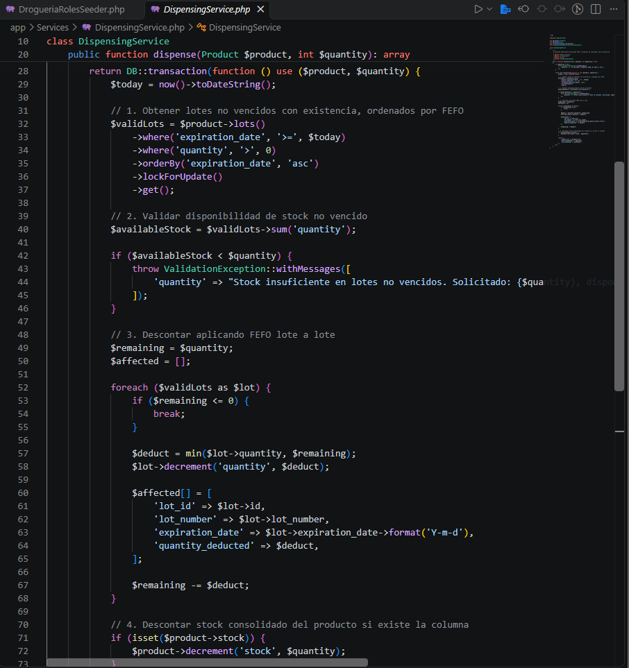
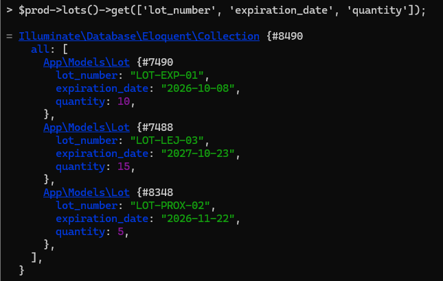
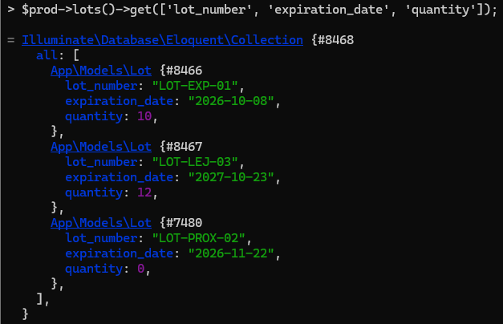
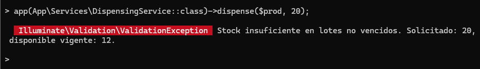

# Análisis de la Droguería Vida Sana
**Asignatura:** Software de Gestión Empresarial — Segundo Parcial  
**Institución:** COTECNOVA 2026  
**Integrantes:** Esteban Molina & Heiber Lozano  
**Repositorio Oficial:** [https://github.com/moliech/parcial2](https://github.com/moliech/parcial2)  
**Rama Oficial de Entrega:** `parcial2`

---

## 1. Flujo integrado

### Descripción paso a paso del ciclo operativo (Procure-to-FEFO)

1. **Detección de Necesidad de Reabastecimiento:**  
   El sistema identifica de manera continua aquellos medicamentos cuyas existencias vigentes y no vencidas han alcanzado o descendido del punto mínimo de reorden (`minimum_stock`).

2. **Generación de la Orden de Compra:**  
   El usuario con rol `admin` (encargado de compras) genera una orden formal dirigida al distribuidor autorizado (ejemplo: *«Distribuidora Farmacéutica del Valle»*), detallando los productos, cantidades solicitadas y precios unitarios acordados. La orden se registra en estado **Pendiente** y su identificador de creador (`user_id`) queda fijado para control de auditoría.

3. **Recepción Física de la Mercancía en Bodega:**  
   Al arribar el despacho a la droguería (sea en una entrega total o en entregas parciales), el usuario con rol `auxiliar-bodega` verifica físicamente las cajas frente a la orden de compra y registra el ingreso en el sistema: producto, número de lote del laboratorio, fecha de vencimiento y cantidad física recibida. El sistema actualiza el acumulado de unidades recibidas (`received_quantity`) en la orden de compra y calcula las diferencias frente a lo solicitado.

4. **Inspección Técnica y Aprobación Sanitaria (Regente de Farmacia):**  
   El `regente` de farmacia (responsable técnico legal ante el INVIMA) realiza la inspección organoléptica, verifica la integridad de los sellos de seguridad, valida las fechas de vencimiento frente a la documentación del fabricante y emite la aprobación técnica. Los productos o lotes que no cumplan los criterios sanitarios se marcan en cuarentena o rechazo, impidiendo su puesta a la venta.

5. **Actualización del Inventario:**  
   Una vez aprobada técnicamente la recepción, el sistema crea o actualiza los registros en la tabla `lots` e incrementa el stock general del producto dentro de una transacción de base de datos (`DB::transaction`). La operación se ejecuta de manera atómica para garantizar que no existan inconsistencias entre las cantidades por lote y el inventario general consolidado.

6. **Venta y Dispensación FEFO en Punto de Venta (POS):**  
   El cliente solicita el medicamento en mostrador. El `cajero` registra los ítems de la venta. El sistema invoca automáticamente el servicio `DispensingService`, el cual:
   * Excluye de forma estricta los lotes vencidos (`expiration_date < today`). Los medicamentos son aptos para la venta hasta el día de su vencimiento inclusive.
   * Valida que la sumatoria de existencias vigentes cubra la cantidad solicitada.
   * Aplica el algoritmo **FEFO** (*First Expired, First Out*), debitando prioritariamente del lote vigente con fecha de expiración más próxima. Si la venta consume existencias de múltiples lotes, se desglosan los renglones correspondientes en el detalle.
   * Si el producto está clasificado como medicamento de control especial, el sistema exige la autorización autenticada del `regente` de farmacia antes de completar el despacho.

7. **Facturación y Registro de Trazabilidad:**  
   Se emite la factura o ticket de venta registrando en cada fila de `sale_details` la clave foránea `lot_id`. Esto permite vincular de forma inequívoca las cantidades dispensadas con su respectivo lote de origen.

8. **Alimentación de Indicadores de Gestión (KPIs):**  
   Cada transacción confirmada actualiza de forma inmediata las métricas gerenciales: rotación de existencias, mermas por vencimiento y alertas de lotes próximos a caducar.

---

## 2. Reglas de negocio

| # | Regla de Negocio | Módulo | DÓNDE se implementa | Mecanismo Técnico en Laravel |
|---|---|---|---|---|
| **R1** | **Prohibición de venta de lotes vencidos:** Un lote cuya fecha de caducidad sea anterior a la fecha actual (`expiration_date < today`) no puede ser dispensado. Un producto es vendible hasta el final de su fecha de vencimiento. | Ventas / POS | **Servicio** (`DispensingService`) | Filtro de consulta: `where('expiration_date', '>=', now()->toDateString())`. |
| **R2** | **Prioridad estricta FEFO (*First Expired, First Out*):** La asignación de existencias para venta debe realizarse siempre en orden cronológico ascendente por fecha de expiración. | Inventario / Ventas | **Servicio** (`DispensingService`) | Ordenamiento determinista en consulta SQL: `orderBy('expiration_date', 'asc')`. |
| **R3** | **Autorización autenticada para medicamentos de control especial:** La dispensación de medicamentos regulados exige validación y registro del regente técnico con trazabilidad de usuario, fecha y operación en la lógica de negocio. | Ventas / Dispensación | **Servicio & Policy** (`SaleService` / `DispensingPolicy`) | Verificación en capa de servicio del permiso `dispensar-control-especial` con registro en bitácora de auditoría. |
| **R4** | **Segregación estricta de funciones en compras y recepción:** El usuario que crea una orden de compra tiene prohibido recibir físicamente o aprobar la mercancía en bodega. | Compras / Bodega | **Policy** (`PurchasePolicy@receive`) | Validación de identidad: `throw_if($user->id === $purchase->user_id, AuthorizationException::class)`. |
| **R5** | **Validación de existencias y atomicidad del despacho:** La cantidad solicitada no puede superar las existencias disponibles en lotes no vencidos. Si el stock es insuficiente, se cancela la operación y no se modifica nada. | Ventas e Inventario | **Servicio** (`DispensingService`) y **Form Request** | Control atómico dentro de `DB::transaction`, aplicando `lockForUpdate()` y lanzamiento de `ValidationException`. |
| **R6** | **Política de aceptación de vencimientos en recepción:** No se admite el ingreso a bodega de lotes vencidos o cuya fecha de expiración sea menor o igual a la fecha de recepción. | Compras / Recepción | **Form Request** (`ReceiveLotRequest`) y **Servicio** | Regla de validación: `'expiration_date' => 'required|date|after:today'`, reforzada en la transacción de recepción. |
| **R7** | **Semáforo de vencimientos en inventario:** Clasificación visual por rangos: Rojo (vencido: `< today`), Naranja (crítico: de hoy a 30 días), Amarillo (preventivo: 31 a 60 días) y Verde (óptimo: `> 60 días`). | Inventario / Catálogo | **Vista** (Blade) / **Presenter** | Comparación temporal determinista basada en fechas límite directas sobre `expiration_date`. |

---

## 3. Estados

### Ciclo de Estados de una Orden de Compra y Efecto en Inventario

| Estado | Significado Operativo | Efecto sobre el Inventario |
| :--- | :--- | :--- |
| **Pendiente** | Orden creada por el administrador y emitida al distribuidor. | **Sin efecto:** El stock físico no se modifica (puede registrarse como stock proyectado). |
| **Recepción Parcial** | El proveedor realizó una entrega parcial verificada en bodega. | **Aumento parcial:** Se incorporan al inventario únicamente las cantidades efectivamente recibidas y aprobadas técnicamente por lote, actualizando `received_quantity`. |
| **Recibida / Completada** | Se completó la entrega del 100% o se formalizó el cierre de la orden. | **Aumento definitivo:** Se consolidan todas las cantidades aprobadas en la tabla `lots` y en el stock general del producto. |
| **Cancelada** | Orden anulada por el proveedor o por la droguería antes de recibir mercancía. | **Sin efecto:** No produce ninguna variación en el inventario. |

### Ciclo de Estados de una Venta y Efecto en Inventario

| Estado de Venta | Significado Operativo | Efecto sobre el Inventario |
| :--- | :--- | :--- |
| **Pendiente** | Venta en proceso de captura o registro en caja. | **Sin efecto definitivo:** No produce descuento físico de inventario. Los bloqueos de fila con `lockForUpdate` operan exclusivamente dentro de la transacción activa de cobro para evitar colisiones. |
| **Completada / Pagada** | Transacción cobrada y comprobante emitido. | **Descuento definitivo y atómico:** Se descuentan las cantidades de los lotes seleccionados mediante FEFO y se reduce el stock general del producto dentro de `DB::transaction`. |
| **Anulada antes de despacho** | Transacción cancelada en caja sin entrega física. | **Sin efecto:** No se altera el inventario. |
| **Devuelta** | Mercancía devuelta por el cliente tras autorización sanitaria. | **Reintegro condicionado:** Solo se reincorpora al lote original si el empaque está íntegro, el regente lo aprueba y la fecha de expiración sigue vigente. |

---

## 4. Indicadores de Gestión (KPIs)

### KPI 1: Unidades de Medicamentos Próximas a Vencer (≤ 30 días)
* **Objetivo:** Identificar oportunamente el volumen físico de medicamentos en riesgo inminente de caducidad para priorizar su rotación, gestionar devoluciones a distribuidores o activar estrategias comerciales antes de generar pérdidas.
* **Fórmula de Cálculo:**
  ```text
  KPI 1 = SUM(quantity) 
  Filtro: quantity > 0 AND expiration_date BETWEEN today AND (today + 30 días)
  ```
  *Donde se consideran todos los lotes vigentes con existencias mayores a cero cuya fecha de expiración se encuentre dentro de los próximos 30 días calendario inclusive.*
* **Unidad de Medida:** Unidades físicas de producto (número entero).

### KPI 2: Índice de Merma Sanitaria por Vencimiento (%)
* **Objetivo:** Medir el porcentaje del valor económico del inventario que se pierde debido a medicamentos que caducaron en los estantes y debieron ser dados de baja para destrucción sanitaria.
* **Fórmula de Cálculo:**
  ```text
  KPI 2 = (Costo total de bajas por vencimiento en el período / Costo promedio del inventario en el período) * 100
  ```
* **Unidad de Medida:** Porcentaje (%).

### KPI 3: Porcentaje de Cumplimiento de Dispensación FEFO (%)
* **Objetivo:** Evaluar la efectividad del sistema informático en garantizar que todas las ventas realizadas hayan respetado estrictamente la salida del lote con fecha de expiración más antigua disponible.
* **Fórmula de Cálculo:**
  ```text
  KPI 3 = (Número de despachos ejecutados en estricto orden FEFO / Total de despachos evaluados) * 100
  ```
* **Unidad de Medida:** Porcentaje (%). Meta esperada: **100%**.

---

## 5. Diseño del Modelo de Datos

### Diagrama Entidad-Relación
El diagrama oficial con cardinalidades normalizadas se encuentra exportado en:  
`docs/parcial2/er_drogueria.png`.

Relaciones obligatorias implementadas:
* `products` 1 : N `lots`
* `providers` 1 : N `purchases`
* `purchases` 1 : N `purchase_details`
* `products` 1 : N `purchase_details`
* `clients` 1 : N `sales`
* `sales` 1 : N `sale_details`
* `products` 1 : N `sale_details`
* `lots` 1 : N `sale_details`
* `users` 1 : N `purchases` (creador de compra)
* `users` 1 : N `sales` (cajero que despacha)
* `users` M : N `roles` (a través de `model_has_roles` de Spatie)

---

### Diccionario de Datos

#### 1. Tabla: `lots`
Almacena las fracciones de existencias recibidas de los fabricantes, identificadas por número de lote y vencimiento.

| Campo | Tipo | Nulo | Clave / Índice | Descripción | Restricciones / Reglas |
|---|---|:---:|:---:|---|---|
| `id` | BIGINT UNSIGNED | NO | PK, AUTO_INCREMENT | Identificador único del lote. | Valor positivo autoincremental. |
| `product_id` | BIGINT UNSIGNED | NO | FK | Medicamento al que pertenece el lote. | Foreign Key &rarr; `products(id)`, `ON DELETE CASCADE`. |
| `lot_number` | VARCHAR(100) | NO | UNIQUE COMPUESTO | Código alfanumérico del lote impreso por el laboratorio. | Obligatorio. Índice único: `UNIQUE(product_id, lot_number)`. |
| `expiration_date` | DATE | NO | INDEX | Fecha de caducidad del lote según empaque. | Formato `YYYY-MM-DD`. Indexado para consultas FEFO rápidas. |
| `quantity` | INT UNSIGNED | NO | - | Existencias físicas disponibles para venta en el lote vigente. | Default `0`, restricción lógica `quantity >= 0`. |
| `created_at` / `updated_at` | TIMESTAMP | SÍ | - | Marcas de tiempo de auditoría. | Estándar de Laravel. |

#### 2. Tabla: `purchase_details`
Registra los renglones individuales pertenecientes a una orden de abastecimiento.

| Campo | Tipo | Nulo | Clave / Índice | Descripción | Restricciones / Reglas |
|---|---|:---:|:---:|---|---|
| `id` | BIGINT UNSIGNED | NO | PK, AUTO_INCREMENT | Identificador del ítem de compra. | Autoincremental. |
| `purchase_id` | BIGINT UNSIGNED | NO | FK | Orden de compra cabecera asociada. | Foreign Key &rarr; `purchases(id)`, `ON DELETE CASCADE`. |
| `product_id` | BIGINT UNSIGNED | NO | FK | Producto solicitado al distribuidor. | Foreign Key &rarr; `products(id)`, `ON DELETE RESTRICT`. |
| `quantity` | INT UNSIGNED | NO | - | Cantidad total de unidades solicitadas en la orden. | `CHECK (quantity > 0)`. |
| `received_quantity`| INT UNSIGNED | NO | - | Cantidad acumulada de unidades efectivamente recibidas. | Default `0`, `received_quantity <= quantity`. |
| `unit_cost` | DECIMAL(12,2) | NO | - | Precio unitario de compra pactado con distribuidor. | `unit_cost >= 0`. |
| `subtotal` | DECIMAL(14,2) | NO | - | Monto subtotal del renglón (`quantity * unit_cost`). | Calculado, valor positivo. |
| `created_at` / `updated_at` | TIMESTAMP | SÍ | - | Marcas de tiempo. | Estándar de Laravel. |

*Alcance de recepción:* En este modelo, `received_quantity` controla las entregas acumuladas frente a lo pedido. Al aprobarse una entrega, las unidades se incorporan directamente a la tabla `lots` para disponibilidad inmediata, sin requerir tablas intermedias adicionales dentro del alcance del examen.

#### 3. Tabla: `sale_details`
Registra las líneas de detalle de cada venta, garantizando la trazabilidad de cantidades dispensadas por lote.

| Campo | Tipo | Nulo | Clave / Índice | Descripción | Restricciones / Reglas |
|---|---|:---:|:---:|---|---|
| `id` | BIGINT UNSIGNED | NO | PK, AUTO_INCREMENT | Identificador del ítem facturado. | Autoincremental. |
| `sale_id` | BIGINT UNSIGNED | NO | FK | Factura o venta cabecera a la que pertenece. | Foreign Key &rarr; `sales(id)`, `ON DELETE CASCADE`. |
| `product_id` | BIGINT UNSIGNED | NO | FK | Medicamento dispensado. | Foreign Key &rarr; `products(id)`, `ON DELETE RESTRICT`. |
| `lot_id` | BIGINT UNSIGNED | NO | FK | Lote específico del que salieron las unidades. | Foreign Key &rarr; `lots(id)`, `ON DELETE RESTRICT`. Obligatorio. |
| `quantity` | INT UNSIGNED | NO | - | Cantidad de unidades debitadas de ese lote específico. | `CHECK (quantity > 0)`. |
| `unit_price` | DECIMAL(12,2) | NO | - | Precio unitario de venta al cliente. | `unit_price >= 0`. |
| `subtotal` | DECIMAL(14,2) | NO | - | Monto subtotal de la línea (`quantity * unit_price`). | Calculado, valor positivo. |
| `created_at` / `updated_at` | TIMESTAMP | SÍ | - | Marcas de tiempo. | Estándar de Laravel. |

---

### Justificación Técnica: ¿En qué tabla se guarda de qué lote salió cada unidad vendida?

* **Respuesta:** Se guarda en la tabla **`sale_details`** mediante la columna foránea **`lot_id`** asociada a `lots(id)`.
* **Fundamentación Técnica y Sanitaria:**  
  Bajo la regulación sanitaria (INVIMA), es mandatorio asegurar la **trazabilidad de las cantidades dispensadas por lote**. Como una venta por una cantidad determinada de un producto puede suministrarse combinando existencias de **dos o más lotes distintos** debido al despacho FEFO, cada fila de `sale_details` representa las unidades extraídas de un lote particular.  
  Por ejemplo, si un cliente adquiere 8 tabletas de *Amoxicilina* y el inventario vigente dispone de 5 unidades en el lote `L2` (vencimiento próximo) y 15 unidades en el lote `L3` (vencimiento posterior), el sistema genera **dos registros independientes en `sale_details`** dentro de la misma factura:

  | sale_id | product_id | lot_id | quantity | unit_price | subtotal |
  | :---: | :---: | :---: | :---: | :---: | :---: |
  | 101 | 4 | 2 (`L2`) | 5 | $1.500 | $7.500 |
  | 101 | 4 | 3 (`L3`) | 3 | $1.500 | $4.500 |

  Esto asegura que ante un retiro sanitario (*recall*) de un lote por parte de la autoridad, se consulte en segundos exactamente en qué facturas y a qué clientes se entregaron unidades de dicho lote.

---

## 6. Matriz de seguridad

### Matriz Detallada Rol × Módulo × Acción

La siguiente matriz desglosa de manera canónica los permisos asignados a cada uno de los cuatro roles definidos para la Droguería Vida Sana:

| Módulo | Acción Específica / Permiso | admin (Dueño) | regente | cajero | auxiliar-bodega |
| :--- | :--- | :---: | :---: | :---: | :---: |
| **Productos** | `ver-productos` | ✅ Sí | ✅ Sí | ✅ Sí | ✅ Sí |
| | `crear-productos` | ✅ Sí | ❌ No | ❌ No | ❌ No |
| | `editar-productos` | ✅ Sí | ✅ Sí (Ficha técnica) | ❌ No | ❌ No |
| | `eliminar-productos` | ✅ Sí (Borrado lógico) | ❌ No | ❌ No | ❌ No |
| **Lotes** | `ver-lotes` | ✅ Sí | ✅ Sí | ✅ Sí (Consulta) | ✅ Sí |
| | `crear-lotes` | ❌ No | ❌ No | ❌ No | ✅ Sí (En recepción) |
| | `ajustar-lotes` | ✅ Sí | ✅ Sí (Inspección) | ❌ No | ❌ No |
| **Compras** | `ver-compras` | ✅ Sí | ✅ Sí | ❌ No | ✅ Sí (Para recibir) |
| | `crear-compras` | ✅ Sí | ❌ No | ❌ No | ❌ No |
| | `aprobar-compras` | ✅ Sí | ❌ No | ❌ No | ❌ No |
| | `cancelar-compras` | ✅ Sí | ❌ No | ❌ No | ❌ No |
| **Recepción en Bodega** | `recibir-lotes` *(descarga física)* | ❌ No (Segregación) | ❌ No | ❌ No | ✅ Sí (Descarga física) |
| | `aprobar-recepcion-sanitaria` | ❌ No | ✅ Sí (Aprobación técnica) | ❌ No | ❌ No |
| **Control Especial** | `dispensar-control-especial` | ❌ No | ✅ Sí (Exclusivo) | ❌ No | ❌ No |
| **Ventas POS** | `ver-ventas` | ✅ Sí | ✅ Sí (Auditoría) | ✅ Sí | ❌ No |
| | `crear-ventas` | ❌ No | ❌ No | ✅ Sí | ❌ No |
| | `anular-ventas` | ✅ Sí | ❌ No | ❌ No | ❌ No |
| **Indicadores / KPIs** | `ver-kpis` | ✅ Sí (Dashboard total) | ✅ Sí (Sanitarios) | ❌ No | ❌ No |

*Nota de implementación Spatie:* En el seeder `DrogueriaRolesSeeder`, la acción propia de recepción se mapea con el permiso `recibir-lotes` para el `auxiliar-bodega`, mientras que el `regente` ostenta `ajustar-lotes` y `dispensar-control-especial` para su función de control sanitario. El `admin` carece de permisos de recepción para blindar la segregación.

---

### Explicación de la Segregación de Funciones

La segregación de funciones previene fraudes, compras ficticias y alteraciones no supervisadas del stock:
1. **Separación de roles:** El rol `admin` ostenta los permisos de adquisición (`crear-compras`, `aprobar-compras`), pero tiene **explícitamente denegado el permiso `recibir-lotes`**.
2. **Recepción independiente:** La recepción física la ejecuta exclusivamente el `auxiliar-bodega`, mientras que la verificación técnica la formaliza el `regente`.
3. **Validación técnica en software:** Adicionalmente a los roles de Spatie, la capa de políticas (`PurchasePolicy@receive`) valida que el identificador del usuario que intenta registrar la recepción sea estrictamente diferente al creador de la orden:
   ```php
   public function receive(User $user, Purchase $purchase): bool
   {
       // Quien compra no puede recibir, incluso si tuviera permisos administrativos
       return $user->hasPermissionTo('recibir-lotes') && $user->id !== $purchase->user_id;
   }
   ```

---

### Caso Práctico: El regente cubre la caja los sábados

#### 1. ¿Se le asignaría un segundo rol o un permiso directo? ¿Por qué?
Se le debe asignar un **segundo rol (`cajero`)** mediante el paquete Spatie:
```php
$user->assignRole(['regente', 'cajero']);
```
**Justificación:**
* **Mantenimiento del modelo RBAC (*Role-Based Access Control*):** Asignar permisos directos individuales a un usuario fragmenta las políticas de seguridad, degrada la auditoría y genera acumulación descontrolada de privilegios (*permission creep*).
* **Modularidad y revocabilidad:** Al asignarle el rol completo de `cajero`, sus atribuciones operativas de venta quedan claramente agrupadas y tipificadas. Cuando finaliza su temporada de cobertura o sus turnos de fin de semana, el rol puede removerse con `$user->removeRole('cajero')` sin alterar sus permisos de regente ni dejar permisos huérfanos.

#### 2. ¿Qué rol elegiría al iniciar sesión?
El usuario inicia sesión seleccionando el rol operativo de **`cajero`** para sus labores de atención en mostrador y facturación POS.  
Bajo los principios de control interno y buenas prácticas farmacéuticas, si durante su turno como cajero se presenta una venta de medicamentos de control especial, la transacción **no debe autoautorizarse silenciosamente**: el sistema debe solicitar la confirmación de credenciales técnicas de regente o exigir la intervención del regente de turno de apoyo, dejando un registro explícito en el log de auditoría para garantizar que no se eludan los controles de separación de funciones.

---

## 7. Evidencias de la Implementación (Punto 4)

A continuación se presentan las evidencias directas del código fuente, estructura de base de datos y validaciones transaccionales en Laravel Tinker conforme a la rúbrica del parcial:

### 7.1 Estructura de la Tabla `lots` en MySQL
Captura de la ejecución del comando `DESCRIBE lots;` verificando tipos de datos (`bigint unsigned`, `varchar(100)`, `date`, `int unsigned`) e índices clave:



---

### 7.2 Código Fuente de los Componentes Desarrollados

#### A. Modelo `Lot.php`
Implementación de los atributos masivos (`$fillable`), conversión de tipos (`$casts` para `date` e `integer`) y relación `belongsTo(Product::class)`:



#### B. Seeder de Seguridad `DrogueriaRolesSeeder.php`
Definición e inicialización de la matriz de permisos y roles (`admin`, `regente`, `cajero`, `auxiliar-bodega`) mediante el paquete Spatie:



#### C. Servicio Transaccional `DispensingService.php`
Servicio encargado del despacho con lógica FEFO, validación de caducidad, bloqueo pesimista y atomicidad mediante `DB::transaction()`:



---

### 7.3 Pruebas de Funcionamiento en Laravel Tinker

#### A. Estado Inicial de Lotes (Antes del Despacho)
Creación del escenario de pruebas con tres lotes para el producto *Amoxicilina 500mg*:
1. `LOT-EXP-01` (Vencido hace 15 días, cantidad: 10).
2. `LOT-PROX-02` (Próximo a vencer en 30 días, cantidad: 5).
3. `LOT-LEJ-03` (Vence en 1 año, cantidad: 15).



#### B. Despacho Aplicando FEFO (Después del Despacho)
Se solicitan **8 unidades** mediante `$service->dispense($prod, 8)`. El sistema:
- Ignora por completo el lote vencido `LOT-EXP-01` (permanece con 10 unidades).
- Consume la totalidad del lote más próximo `LOT-PROX-02` (5 unidades descontadas, saldo: 0).
- Descuenta las 3 unidades restantes del lote `LOT-LEJ-03` (saldo resultante: 12 unidades).



#### C. Control de Excepción al Superar Stock Vigente
Se solicita una dispensación de **20 unidades** cuando el inventario vigente disponible es de únicamente 12 unidades. El sistema bloquea la operación y lanza de forma controlada la excepción `ValidationException`:



